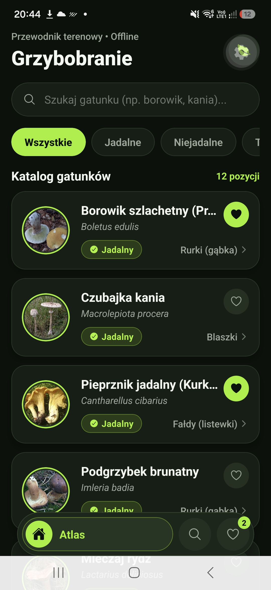
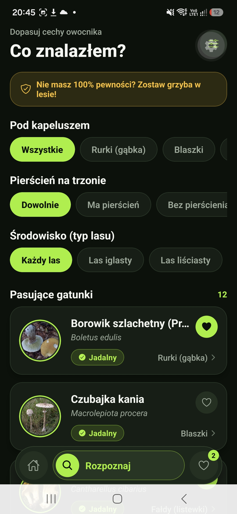
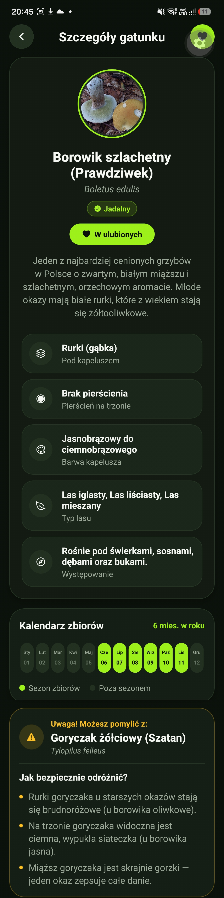
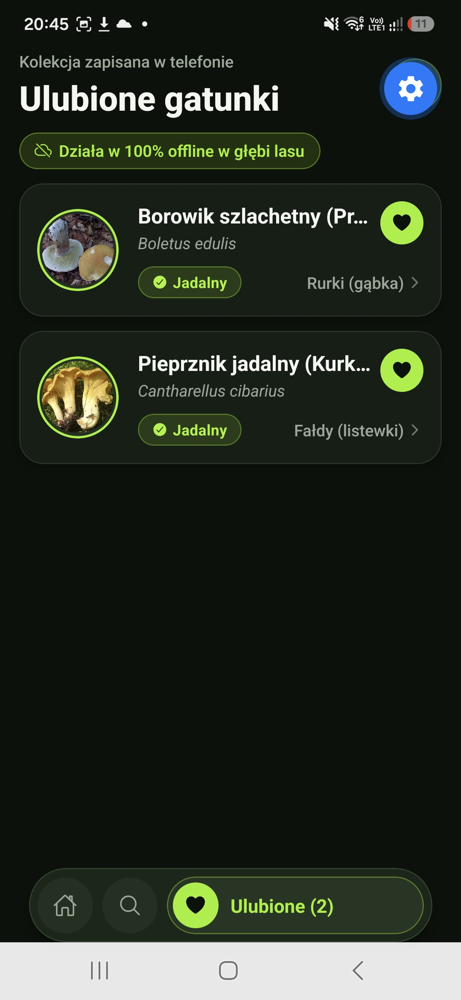

# 🍄 Grzybobranie — Mobilny Atlas i Klucz do Rozpoznawania Grzybów

Nowoczesna aplikacja mobilna stworzona w **React Native (Expo + TypeScript)** poświęcona tematyce grzybiarstwa w Polsce. Aplikacja działa w **100% w trybie offline** (bez dostępu do internetu w lesie), łącząc ilustrowany atlas grzybów, interaktywny klucz rozpoznawczy, wektorowe wykresy sezonowości oraz ostrzeżenia o groźnych sobowtórach.

## 📱 Zrzuty ekranu

| Atlas gatunków | Klucz rozpoznawczy | Szczegóły i wykres SVG | Ulubione (Offline) |
| :---: | :---: | :---: | :---: |
|  |  |  |  |

## ✨ Główne funkcjonalności

* **Interaktywny Atlas (`Atlas`):** katalog 12 charakterystycznych gatunków polskich lasów z fotografiami, nazwami polskimi i łacińskimi, czytelnymi oznaczeniami jadalności (*Jadalny*, *Niejadalny*, *Trujący*), wyszukiwarką tekstową na żywo oraz szybkim filtrowaniem kategorii.
* **Klucz terenowy (`Rozpoznaj`):** wielokryterialne filtrowanie okazów na podstawie widocznych cech morfologicznych (rodzaj hymenoforu pod kapeluszem: *rurki / blaszki / fałdy*, obecność pierścienia na trzonie oraz typ lasu).
* **Karta szczegółów, kalendarz SVG i alerty bezpieczeństwa:** szczegółowy opis gatunku, wektorowy wykres sezonowości zbiorów w ujęciu 12 miesięcy (`react-native-svg`) oraz wyraźny moduł ostrzegający przed trującymi lub niejadalnymi sobowtórami (*Uwaga! Możesz pomylić z...*).
* **Zapis danych offline (`Ulubione`):** trwałe przechowywanie wybranych gatunków w pamięci urządzenia (`@react-native-async-storage/async-storage`) z natychmiastową aktualizacją licznika na pływającym pasku nawigacji (*Floating Pill Dock*).
* **Dopracowany UI/UX i mikroanimacje:** autorska ciemna stylistyka leśna (*Dark Moss & Neon Lime*) o wysokim kontraście w terenie, kaskadowe animacje wejścia list (`FadeInDown`) oraz sprężyste mikroanimacje przycisków (`withSpring`).

## 🤖 Platforma docelowa i testowanie

* **Główny system docelowy:** **Android** *(projekt zachowuje pełną kompatybilność z iOS w ekosystemie Expo)*.
* **Testowanie na fizycznym urządzeniu:** **Tak** — aplikacja została przetestowana na **fizycznym smartfonie z systemem Android** (poprzez Expo Go) oraz zweryfikowana pod kątem działania na **emulatorze systemu Android**.

## 🛠️ Wykorzystane technologie

* **React Native** + **Expo** + **TypeScript** (`strict: true`)
* **Expo Router** — nawigacja plikowa (`src/app/`), dynamiczne ścieżki (`mushroom/[id]`) oraz własny pływający pasek zakładek
* **React Native Reanimated** & **React Native Gesture Handler** — płynne mikroanimacje interfejsu
* **React Native SVG** — wektorowy wykres sezonowości występowania gatunków
* **AsyncStorage** — lokalny zapis ulubionych grzybów dostępny bez zasięgu sieci

## 📂 Struktura projektu

```bash
grzybobranie/
├── assets/images/mushrooms/   # Zestaw lokalnych fotografii gatunków (offline)
├── docs/                      # Zrzuty ekranu aplikacji do dokumentacji
├── src/
│   ├── app/                   # Ekrany i nawigacja Expo Router ((tabs) + mushroom/[id])
│   ├── components/            # Komponenty wielokrotnego użytku (karty, wykres SVG, badge, chipy)
│   ├── constants/             # System projektowy i paleta kolorów (theme.ts)
│   ├── context/               # Globalna synchronizacja stanu ulubionych (FavoritesContext)
│   ├── data/                  # Baza gatunków grzybów i słowniki etykiet
│   ├── hooks/                 # Logika wyszukiwania i filtrowania cech (useMushroomFilter)
│   ├── storage/               # Obsługa pamięci lokalnej AsyncStorage
│   └── types/                 # Definicje interfejsów i typów TypeScript
├── app.json
└── tsconfig.json
```

## 🚀 Instrukcja uruchomienia

1. **Sklonuj repozytorium i przejdź do katalogu projektu:**
   ```bash
   git clone <ADRES_TWOJEGO_REPOZYTORIUM_GITHUB>
   cd grzybobranie
   ```

2. **Zainstaluj zależności:**
   ```bash
   npm install
   ```

3. **Uruchom serwer deweloperski Expo:**
   ```bash
   npx expo start
   ```

4. **Otwórz aplikację:**
   * **Emulator Android:** naciśnij klawisz **`a`** w terminalu (przy uruchomionym Android Studio Emulator).
   * **Fizyczny telefon:** zainstaluj aplikację **Expo Go** ze sklepu Google Play / App Store i zeskanuj kod QR widoczny w terminalu.